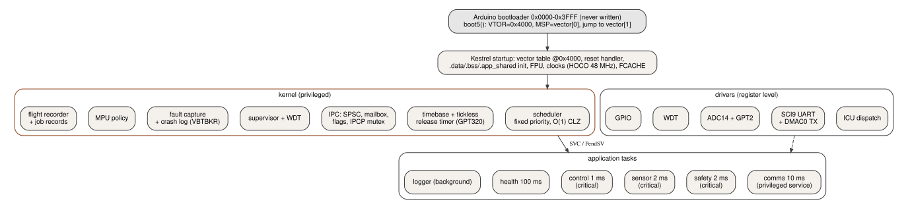
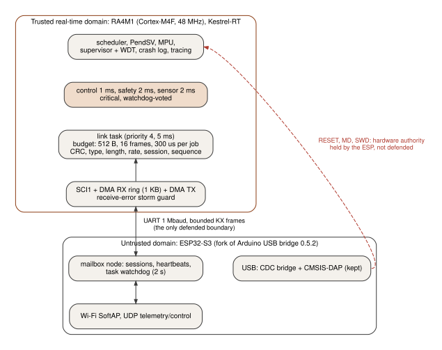
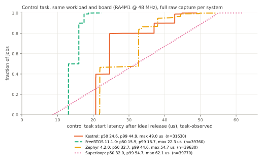

# Kestrel-RT

**A zero-allocation bare-metal real-time runtime in C for ARM Cortex-M4F, extended into a split-criticality dual-processor architecture.**

Kestrel-RT was built from the reset vector upward on a 48 MHz Renesas RA4M1. It implements custom startup,
fixed-priority preemptive scheduling, PendSV context switching, MPU protection, watchdog supervision,
DMA-backed I/O, crash capture, binary tracing and fault injection. Phase 2 isolates the real-time domain
from an ESP32-S3 networking processor over a bounded UART/DMA protocol.

Everything below was measured on physical hardware. The evaluation platform is an Arduino UNO R4 WiFi
board (RA4M1 + ESP32-S3); no Arduino core, FSP or vendor RTOS runs in the runtime. The code is about 4,500
non-blank lines of C plus 125 of assembly for the runtime, and about 750 for the Phase 2 link.

<p align="center"><a href="https://youtu.be/AfcJQIyyuUY"></a></p>
<p align="center"><sub>25 s video, with live screen recording from the physical board (<a href="docs/DEMO.md">demo script and full transcript</a>)</sub></p>

| Headline (physical board) | Result |
|---|---|
| Phase 1 soak | **10,429,500** control periods (2.9 h), **0** deadline misses, 0 overruns, 0 faults, no reset |
| Phase 1 fault campaign | **17/17** cases pass on the final firmware (MPU, bus, usage faults, asserts, hangs) |
| Phase 2 soak | **10,003,440** control periods with **11 forced ESP32-S3 crashes**: **0** RA4 resets, **0** critical misses, **0** protocol desyncs |
| Phase 2 cost | a fixed **+3.3 us** at control start-latency p99 (44.54 -> 47.88 us), whatever the ESP does |
| Against FreeRTOS 11.1.0 | **FreeRTOS is faster**: control start p50 15.9 us vs Kestrel 24.6 us (details below) |

**Written for this project, from the reset vector up:** startup code and linker script, clock and flash setup,
the tickless fixed-priority scheduler and task model, PendSV context switching (FPU-aware), bounded IPC (SPSC
queues, seqlock mailboxes, event flags), the priority-ceiling mutex, MPU isolation, the watchdog supervisor,
fault capture and the crash log, binary tracing, register-level DMA drivers, the fault injector, the Phase 2
RA4M1/ESP32-S3 mailbox protocol and link task, and the ESP32-S3 fault-containment changes (sessions, resync,
task watchdog, RESET-glitch fix). Third-party code in the runtime: the CMSIS register headers only.

**Same workload on the same board, control-task start latency (us):**

| | Kestrel | FreeRTOS 11.1.0 | Zephyr 4.2.0 | Superloop |
|---|---:|---:|---:|---:|
| p50 / p99 | 24.6 / 44.9 | **15.9 / 18.7** | 32.7 / 44.6 | 32.0 / 54.7 |
| at 7x overload | control at half rate, other tasks 0 misses | control misses every job, other tasks starve | not measured | every task misses |

FreeRTOS is faster on this path. Kestrel was built for ownership, analyzability and defined fault and overload
behavior, not to win the latency benchmark.

**Limits, up front:** one board tested; not certified (RTOS, MISRA, SIL) and not formally verified; Phase 2 is
fault isolation, not a security boundary (the ESP32-S3 still controls the RA4M1's reset and SWD lines); no motor
was driven; the cause of the +3.3 us Phase 2 cost is not isolated. Full list below and in
[docs/LIMITATIONS.md](docs/LIMITATIONS.md).

**What went wrong on the way** (kept, with root causes and fixes): [docs/ENGINEERING_LOG.md](docs/ENGINEERING_LOG.md).
**Live demo** on the board in about two minutes: [docs/DEMO.md](docs/DEMO.md).

## Architecture



Phase 1 is one processor: the untouched Arduino bootloader hands over to Kestrel's own startup at 0x4000,
which brings up clocks, the MPU, the fault handlers, the watchdog supervisor and the tracing, then starts
six tasks. Control (1 ms), safety (2 ms) and sensor (2 ms) are critical and watchdog-voted. Comms is a
privileged service, and health and logger run unprivileged. Details: [ARCHITECTURE](docs/ARCHITECTURE.md),
[SCHEDULER](docs/SCHEDULER.md), [CONTEXT_SWITCH](docs/CONTEXT_SWITCH.md), [MEMORY](docs/MEMORY.md),
[FAULT_HANDLING](docs/FAULT_HANDLING.md), [DRIVERS](docs/DRIVERS.md).



Phase 2 adds the board's ESP32-S3 as an **untrusted** networking domain (Wi-Fi, telemetry, USB/debug
bridge). The RA4M1 talks to it only through a DMA ring and a budgeted priority-4 task that validates every
frame. **Trust-boundary limitation:** the ESP32-S3 still physically owns the RA4M1's RESET line, its boot-mode
pin and its SWD debug port (board design). Phase 2 therefore demonstrates **fault isolation**, not a
hardened security boundary. Details: [PHASE2_ARCHITECTURE](docs/PHASE2_ARCHITECTURE.md) (full diagram),
[PROTOCOL](docs/PHASE2_PROTOCOL.md), [INTERCONNECT](docs/PHASE2_INTERCONNECT.md),
[FAULT_MODEL](docs/PHASE2_FAULT_MODEL.md), [RECOVERY](docs/PHASE2_RECOVERY.md).

## Phase 1 results

Same six-task workload, same drivers and the same measurement method on four systems (30 s, control task, start
latency = ideal release to the task's first instruction). Source: [BENCHMARKS](docs/BENCHMARKS.md).



| Runtime | p50 (us) | p99 (us) | max (us) | Relevant observation |
|---|---:|---:|---:|---|
| Superloop | 32.0 | 54.7 | 62.1 | non-preemptive; loses control deadlines from 5.5x load |
| FreeRTOS 11.1.0 | **15.9** | **18.7** | **22.3** | **lowest and tightest latency**, smallest kernel; at 7x overload control misses every job and all other tasks starve |
| Zephyr 4.2.0 | 32.7 | 44.6 | 54.7 | Kestrel matches it at p99 and beats it at p50 |
| Kestrel | 24.6 | 44.9 | 49.0 | per-job deadline accounting, MPU, crash capture; at 7x overload control degrades to half rate, other tasks keep deadlines |

FreeRTOS's tick handler does very little. Kestrel's kernel timer ISR does per-job deadline and latency
bookkeeping and 64-bit tickless timekeeping, and each switch retargets the MPU. That is where the difference
goes.

| Measurement | Result |
|---|---|
| Footprint (linker map) | kernel **12,291 B flash / 5,967 B RAM**; complete benchmark image **23,046 B flash / 20,569 B RAM** (FreeRTOS kernel 2,832 / 897) |
| Context switch, signal-to-wake p50 | Kestrel 13.0 us (unprivileged, MPU on) vs FreeRTOS 10.3 us (notifications, no MPU); MPU costs ~0.3 us per switch pair |
| Kernel internals (DWT cycles, p50 / max) | PendSV 316 / 654, timer ISR 416 / 1,071 |
| Soak | 10,429,500 control jobs: p50 24.5, p99 45.0, p99.99 46.5, max 50.5 us; p50/p99 identical in both full hours |
| Interrupt storm, priority above all tasks | 0 misses up to **300 kHz** (control p99 54.6 us); same for FreeRTOS |
| Telemetry stall, 5 s on-target | 0 critical misses, p99 unchanged, 10,380 records dropped and counted = host's gap count |
| Host stops reading, 16.9 s | 0 misses on every task |
| Priority inversion | high-priority blocking 5,173 us with a plain mutex, **909 us** with the priority-ceiling mutex |
| Fault campaign | contained faults in unprivileged tasks: task parked, **0 control misses**; critical-task faults and hangs: record + reset, recovery 0.76 s (fault) / 1.00 s (watchdog) |
| Watchdog policy | noncritical hangs only set a degraded flag; critical hangs reset through the WDT |

## Phase 2 results

Gates and kill criteria were frozen before the campaign ([FAULT_MODEL](docs/PHASE2_FAULT_MODEL.md)).
Source: [PHASE2_RESULTS](docs/PHASE2_RESULTS.md).

| What the ESP32-S3 did | RA4M1 outcome |
|---|---|
| Nothing (idle mailbox) vs link compiled out | control p99 47.88 vs 44.54 us: **fixed +3.3 us**; link task 0.83% CPU |
| Wi-Fi UDP flood, **5.9 Mbit/s** delivered | 0 misses, p99 47.88 us, no link outage |
| Both ESP cores saturated; heap held near 5.7 KB | 0 misses, p99 47.88 us |
| **15,000 malformed frames**, 7 classes | **0 accepted**, 0 RA4 faults, 0 resets |
| **83,711 valid frames** in 15 s (UART limit) | 6,335 accepted, 8,526 rate-limited, 1.21 MB dropped at the ring, all counted; worst link job 314 us (limit 400) |
| TX line held low 15 s | 19,200 receive errors bounded by the storm guard, link resumed |
| Panic, watchdog hang, 5-reboot loop | 0 RA4 resets, 0 misses, a new session after every ESP boot (outages 0.3 to 2.3 s) |
| **32 stale frames replayed** after an ESP reboot | **32/32 rejected**; a pre-reboot config request not re-applied |
| **Soak: 10,003,440 control periods, 11 forced crashes** | **0 RA4 resets, 0 critical misses, 0 desyncs**; 11 outages, 4.34 s total |

Recovery was physically verified: the ESP32-S3 was put into ROM download mode, restored to the official
Arduino bridge (verified), and reflashed with the fork. The official bridge was seen to reset the RA4M1 at
its own boot (twice). The fork never did.

## Design decisions

Each choice is tied to a measured failure mode in [docs/DESIGN_DECISIONS.md](docs/DESIGN_DECISIONS.md):
static allocation, fixed priorities with skip-release overruns, PendSV switching, bounded IPC, the
priority-ceiling mutex, DMA for all UART traffic, watchdog voting, MPU stack/kernel protection,
drop-over-block telemetry, binary tracing and the Phase 2 communications budget.

## What went wrong

The failures found on hardware are kept in the record, each written as failure, root cause, fix and
regression test ([docs/ENGINEERING_LOG.md](docs/ENGINEERING_LOG.md)). Examples:
- Host commands were lost in fault runs 2 and 3: UART overruns while the timer ISR ran. Fixed with DMA reception.
- A contained fault caused a control deadline miss: the handler wrote the crash record in place. The write
  was moved out of the handler.
- **About 1.17 million receive-error interrupts** hit the RA4 while the ESP32-S3 sat in download mode. Fixed
  with the storm guard.
- **The G6 gate failed** in the first campaign: the link job took 507 us against the 400 us limit.
- The link **desynchronized permanently** after 15 s of ESP silence.
- One run was lost to a power loss, and two soak attempts ended early.

## What Kestrel does not claim

- Not a production-certified RTOS. Not MISRA-certified (MISRA-inspired rules, no compliance claim). Not
  SIL-certified. Not formally verified.
- Not a security boundary. The ESP32-S3 keeps physical RESET, boot-mode and SWD control over the RA4M1.
  Phase 2 isolates faults on the UART link only.
- Tested on one physical UNO R4 WiFi.
- FreeRTOS had lower control-start latency and a smaller kernel.
- No real robot or motor was driven. The control workload is a synthetic, timing-representative task set.
- Everything known to be weak or unexplained is in [docs/LIMITATIONS.md](docs/LIMITATIONS.md). That includes
  the unisolated cause of the +3.3 us Phase 2 shift and the starvation of the command path under overload.

## Reproduce

Toolchain: Arm GNU 13.3.Rel1 (`make TOOLCHAIN=...` to relocate), Python 3 with pyserial, pyocd,
pyelftools, matplotlib. Board: UNO R4 WiFi on USB. The upload path goes through the board's own
Arduino bootloader and never writes it (the bootloader block is verified before and after).

Image identity: the Phase 1 numbers come from the benchmark image built at tag `phase1-go-2026-09-30`
(`git checkout phase1-go-2026-09-30 && make APP=benchmark`, kestrel.bin sha256 `3c120c66...8bcb`). At this
release the benchmark image also links the Phase 2 SCI1 driver and ICU table entries and is not
byte-identical (`c65c321b...fd77`); it was not re-measured. `make APP=phase2` at this release reproduces the
validated Phase 2 image exactly (`14c04cb3...58cb`).

```bash
# Phase 1
make APP=benchmark                                   # build/benchmark/kestrel.{elf,bin,map,lst}
make flash APP=benchmark                             # scripts/flash.sh: SWD-assisted bootloader entry + bossac
python3 host/experiment.py run --secs 30             # per-task latency, histograms, CPU share -> results/run.json
python3 host/soak.py soak --hours 2.9                # long soak
python3 host/fault_campaign.py                       # 17-case fault campaign (benchmark image)
make host-test                                       # host tests: ASan/UBSan/TSan, frame + protocol fuzzing
scripts/lint.sh                                      # cppcheck + clang-format gate
scripts/fetch_baselines.sh && make -f baselines/baseline.mk BASE=freertos   # FreeRTOS baseline

# Phase 2 (first: the recovery gate in docs/PHASE2_RECOVERY.md, a verified full backup of your ESP32-S3;
#  the flash/restore scripts are written for this board's backup file name)
scripts/fetch_esp_stock.sh                           # official bridge 0.5.2 image, hash-checked (restore path)
make APP=phase2 && make flash APP=phase2
KX_BRIDGE_REF=/path/to/uno-r4-wifi-usb-bridge esp/build.sh   # ESP32-S3 fork (esp/README.md)
python3 scripts/esp_rom_mode.py && scripts/flash_esp_fork.sh  # ESP ROM download mode, app partition only
scripts/esp_wifi.sh up                               # join the ESP SoftAP (Ethernet stays up)
scripts/phase2_campaign_final.sh                     # baselines, negative controls, fault cases
python3 host/phase2_soak.py soak_p2 --periods 10000000 --crash-every 900
scripts/restore_stock_esp_bridge.sh official         # back to the official Arduino bridge
```

## Quick demo (1 to 2 minutes)

```bash
scripts/demo.sh          # board check, build, flash only if different, timing capture, one contained MPU fault
scripts/demo.sh --esp    # also crashes the ESP32-S3 and shows the RA4M1 kept running (Phase 2 fork required)
scripts/demo_record.sh   # the --esp run for screen recording, with a transcript
```
Lines marked `[live]` come from the board during the run. The closing block quotes the recorded campaigns
from their result files. The demo is a walkthrough, not evidence ([docs/DEMO.md](docs/DEMO.md)).

## Repository

| Path | Contents |
|---|---|
| `startup/ kernel/ arch/ safety/ trace/ drivers/ board/ linker/` | the runtime |
| `link/` | Phase 2 protocol codec, acceptance policy, link task |
| `apps/` | benchmark workload, Phase 2 image, inversion demo, fault injector |
| `baselines/` | superloop, FreeRTOS and Zephyr ports of the same workload |
| `esp/` | ESP32-S3 fork: Kestrel files + an ed script against the upstream sketch |
| `host/ scripts/ tests/` | measurement tools, build/flash/recovery scripts, host tests |
| `results/` | per-run JSON summaries and hashes of the raw captures (raw data kept outside Git) |
| `docs/` | specification, design, results, limitations |

## Status and future work

v1.0 is complete; no further features are planned. Legitimate open questions, not scheduled:
- reproduce the campaigns on a second board;
- isolate the cause of the +3.3 us Phase 2 p99 shift;
- evaluate the runtime on another Cortex-M target;
- formal-verification experiments on the scheduler and IPC primitives.

## Documents

[SPEC](docs/SPEC.md) · [ARCHITECTURE](docs/ARCHITECTURE.md) · [SCHEDULER](docs/SCHEDULER.md) ·
[CONTEXT_SWITCH](docs/CONTEXT_SWITCH.md) · [MEMORY](docs/MEMORY.md) · [FAULT_HANDLING](docs/FAULT_HANDLING.md) ·
[DRIVERS](docs/DRIVERS.md) · [TEST_PLAN](docs/TEST_PLAN.md) · [BENCHMARKS](docs/BENCHMARKS.md) ·
[DESIGN_DECISIONS](docs/DESIGN_DECISIONS.md) · [ENGINEERING_LOG](docs/ENGINEERING_LOG.md) ·
[LIMITATIONS](docs/LIMITATIONS.md) · [PHASE2_RESULTS](docs/PHASE2_RESULTS.md) ·
[PUBLICATION_AUDIT](docs/PUBLICATION_AUDIT.md) · [CHANGELOG](CHANGELOG.md) · [PORTFOLIO](docs/PORTFOLIO.md) ·
[SPLIT_ARCHITECTURE](docs/SPLIT_ARCHITECTURE.md) (historical Phase 1-era plan)

## License

Kestrel-RT is MIT-licensed ([LICENSE](LICENSE)). The vendored CMSIS headers keep their Apache-2.0 license
([LICENSES/Apache-2.0.txt](LICENSES/Apache-2.0.txt)). Arduino's upstream bridge sketch has no license, so
it is not redistributed: the ESP32-S3 fork is rebuilt from your own upstream checkout.
See [THIRD_PARTY_NOTICES.md](THIRD_PARTY_NOTICES.md) and [docs/LICENSING.md](docs/LICENSING.md).
