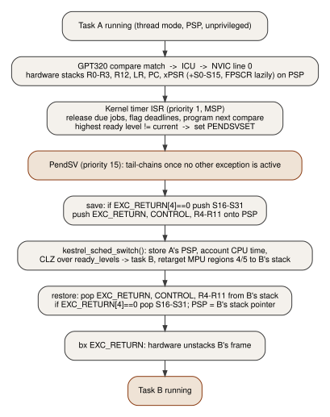
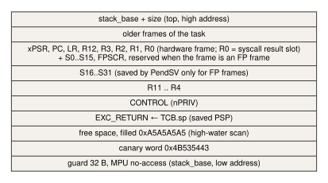

# Context switching

Source: `arch/armv7m/context_switch.S` (PendSV, SVC entry, first-task start), `kernel/scheduler/sched.c`
(`kestrel_sched_switch`), `kernel/task/task.c` (initial frame).

## Stacks and modes

| Context | Mode | Stack | Privilege |
|---|---|---|---|
| application task | thread | PSP (own stack, MPU region 4) | unprivileged unless `KTASK_PRIVILEGED` |
| system task (comms), idle | thread | PSP | privileged |
| ISRs, SVC, PendSV, faults | handler | MSP (2 KB at the top of SRAM, 32 B guard at its bottom) | privileged |

`k_start_first()` moves the boot thread onto a throwaway PSP (`CONTROL.SPSEL = 1`), resets MSP to the top of
the main stack (so the whole MSP is available to handlers), enables interrupts and pends PendSV. The first
PendSV saves that boot context into its throwaway stack and never resumes it.

## Sequence

PendSV has the lowest priority (15), so it runs only after every other active exception has returned
(tail-chaining). Decisions are made elsewhere (timer ISR, SVC); PendSV only performs the switch.

## Exactly what is saved

| Block | Who saves it | Words |
|---|---|---|
| R0-R3, R12, LR, PC, xPSR | hardware at exception entry | 8 |
| S0-S15, FPSCR, reserved | hardware, lazily (FPCCR.LSPEN), only if the task has an active FP context | 18 |
| EXC_RETURN, CONTROL, R4-R11 | PendSV (`stmdb r0!, {r2-r11}`) | 10 |
| S16-S31 | PendSV, only if `EXC_RETURN[4] == 0` (FP frame) | 16 |

- **EXC_RETURN** is saved per task: it says whether the task's frame is a basic or an FP frame, so tasks that
  never touch the FPU never pay for S16-S31.
- **CONTROL** is saved per task for `nPRIV`: privilege is a property of the task, restored on every switch.
  Writes to `CONTROL.SPSEL` are ignored in handler mode; the thread stack is selected by EXC_RETURN.
- **MPU**: `kestrel_sched_switch` retargets region 4 (task stack, RW for the task) and region 5 (32 B no-access
  guard at the stack bottom) to the incoming task: two RBAR/RASR pairs. The exception return that follows is
  context synchronizing, so no extra barrier is needed.
- **Lazy FP and the MPU**: the lazy S0-S15 save of the outgoing task happens when PendSV executes its first
  FP instruction (`vstmdb`), i.e. before the MPU is retargeted, so it lands in the outgoing task's stack with
  the outgoing task's permissions. Everything else in the runtime is compiled with `-mgeneral-regs-only`: if
  kernel C code touched an FP register after the retarget, the deferred save would fault (MLSPERR) on an
  unprivileged stack the MPU no longer maps.

## Initial frame (`task.c`)

A new task's stack holds a fake exception frame: xPSR = 0x01000000 (Thumb), PC = entry, LR =
`k_task_exit_trap` (a task that returns raises SVC 14 and is treated as a fault), R0 = argument; and a software
block with EXC_RETURN = 0xFFFFFFFD (thread, PSP, basic frame), CONTROL = nPRIV. The first dispatch is an
ordinary restore.

## Cost (measured on the RA4M1, not inferred from instruction counts)

PendSV duration is timestamped with DWT CYCCNT at the first and the last instruction of the handler
(`k_pendsv_entry` / `k_pendsv_exit`); includes any higher-priority interrupt that preempts PendSV.

| Metric (6-task benchmark, 15 s, run `baseline_v2c`) | p50 | p95 | p99 | max |
|---|---:|---:|---:|---:|
| PendSV, entry to exception return (cycles @ 48 MHz) | 332 | 368 | 646 | 648 |

The end-to-end task-to-task numbers (system call, scheduler, PendSV, restore) come from the ctxbench
microbenchmark: see `docs/BENCHMARKS.md`.
