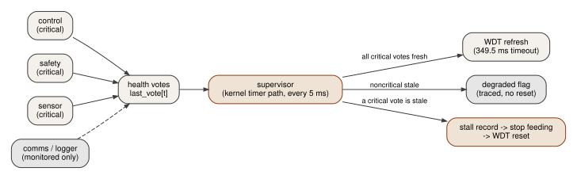

# Fault handling

## Handlers
HardFault, MemManage, BusFault, UsageFault and NMI enter `safety/fault/fault_entry.S`, which passes the
stacked frame (PSP or MSP by EXC_RETURN[2]), EXC_RETURN, IPSR and the entry DWT count to
`kfault_dispatch`. MemManage/BusFault/UsageFault are enabled as separate handlers; divide-by-zero traps
(CCR.DIV_0_TRP). Unaligned accesses stay legal (the compiler relies on them).

## Crash record (`safety/crashlog/crashlog.h`, 124 bytes, CRC-32)
kind, task, flags, boot count, 64-bit timestamp, R0-R3, R12, LR, PC, xPSR, CFSR, HFSR, MMFAR, BFAR, SHCSR, ICSR,
EXC_RETURN, frame address, kind-specific detail (assert line, stalled-task mask), stack high-water, capture
latency. The MPU is switched off during capture so a frame that ends in a guard region can be read; a stacking
error (MSTKERR/STKERR) is flagged because that frame is not trustworthy.

## Policy
| Fault in | Action |
|---|---|
| handler mode (ISR, kernel), privileged task (comms), critical task | durable record, system reset |
| noncritical unprivileged task | record (RAM now, backup registers from the comms task), task FAULTED, switch away, keep running |
| critical task stops voting (hang, starvation, self-detected failure) | supervisor stall record, stop feeding, WDT reset |
| noncritical task stops voting | degraded flag (traced, reported), no reset |

## Retrieval
Host command `get_crash` returns the record plus boot count and reset cause (power-on, WDT, software, ...).
The record survives resets in the VBATT backup registers and is never written to flash.

## Evidence
Hardware campaign results (17 cases, repeated runs) are in docs/TEST_PLAN.md and results/fault_campaign*.json.
