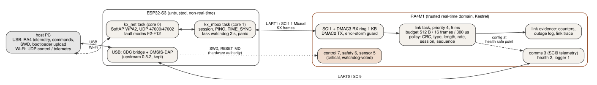

# Phase 2 architecture: split criticality on one board

Claim under test: **no ESP32-S3 behavior (load, saturation, garbage, flood, stall, crash, reboot) causes an
RA4M1 critical deadline miss or reset.** Framing: fault isolation / trust-boundary design, not security
against a malicious ESP (see PHASE2_FAULT_MODEL.md for what the ESP can do physically).

## Domains
| | RA4M1 (trusted, real-time) | ESP32-S3 (untrusted, disposable) |
|---|---|---|
| Software | Kestrel (Phase 1 runtime, unchanged) + Phase 2 link driver and link task | fork of the official Arduino bridge 0.5.2 (Arduino-ESP32 2.0.9 / ESP-IDF 4.4, FreeRTOS) |
| Owns | scheduling, the six-task control workload, the watchdog, fault records, link evidence | Wi-Fi SoftAP, UDP, USB CDC bridge, CMSIS-DAP |
| On the other's failure | marks the link degraded, logs the outage, keeps running; never resets, never feeds or withholds the watchdog because of it | reboots itself (task watchdog 2 s, panic -> reboot), starts a new session |

## RA4 side (what Phase 2 adds; Phase 1 files are unchanged except the ICU event/line table)
- `drivers/uart/sci1_link.c`: SCI1 at 1 Mbaud. RX: DMAC3 repeat mode into a 1 KB ring, no per-byte
  CPU work; the writer position is a free-running byte count from the DMA counters, so a consumer that
  falls a ring behind is detected exactly and resynchronised with the loss counted. TX: DMAC2, nonblocking.
  Error-storm guard: after 32 receive errors in one service window the receiver is muted for 20 ms
  (found necessary on hardware: a line held low produced about 100,000 error interrupts per second).
- `link/xlink.c`: protocol codec and acceptance policy (PHASE2_PROTOCOL.md). Portable, fuzzed on the host.
- `link/link_task.c`: priority 4 (below control 7, safety 6, sensor 5; above comms 3), period 5 ms,
  privileged, noncritical. Per job: <= 512 bytes, <= 16 frames, <= 300 us; double-buffered TX; loss
  detection (250 ms), outage log, link trace, heartbeat/status/metrics/fault/pong/ack emission.
- `apps/phase2/main.c`: the Phase 1 benchmark workload unchanged, plus the link task, plus two host
  commands for link evidence. Build variants: `KESTREL_PHASE2_LINK=0` (B0/N1), `LINK_N3_DISCARD=1`,
  `LINK_N4_SYNTH_US=300`.

Why this bounds the ESP's influence on critical timing:
1. Bytes arrive by DMA; the only per-event CPU work the ESP can cause is the error interrupt (bounded by
   the storm guard) and one DMA re-arm per 64 MB.
2. All parsing happens in a task that every critical task preempts, with a per-job budget; a flood can
   delay only the link task itself and tasks below it.
3. Nothing the ESP sends reaches a critical task's state; configuration is whitelisted, noncritical and
   applied at the owning task's safe point.
4. The watchdog is fed from the critical tasks' votes only (Phase 1 supervisor); link health is monitored.
5. Link evidence lives on the RA4 and is read over the USB path after the ESP recovers, so an ESP crash
   cannot erase the proof that the RA4 survived it.

## ESP side (`esp/KestrelBridge`)
- Kept from upstream: USB 2341:1002 identity, CMSIS-DAP with the 0xAA ROM-mode feature report, USB CDC
  <-> UART0 bridge, 1200-baud (RA4 bootloader) and 2400-baud (RA4 ROM boot) handling. The RA4 is still
  flashed and verified through the fork exactly as in Phase 1 (`scripts/flash.sh`).
- Removed: the AT-command server (and with it the Arduino WiFiS3 library path on the RA4).
- Changed: RESET/MD are driven high before they become outputs (upstream pulsed RA4 RESET on every ESP
  boot); stdout/ROM log redirection to the USB CDC removed (it mixed ESP logs into the RA4 stream).
- Added: `kx_node.cpp` (mailbox task, net task, fault modes), SoftAP (password in gitignored
  `esp/secrets.env`), UDP 47000 control/telemetry, 47002 sink.
- Build: `esp/build.sh` stages the pinned upstream sources (tag 0.5.2) unmodified next to the fork's
  files and the shared protocol C files. Flash: `scripts/flash_esp_fork.sh` writes app0 (0x50000) only,
  from ROM download mode. Rollback: `scripts/restore_stock_esp_bridge.sh official`.
